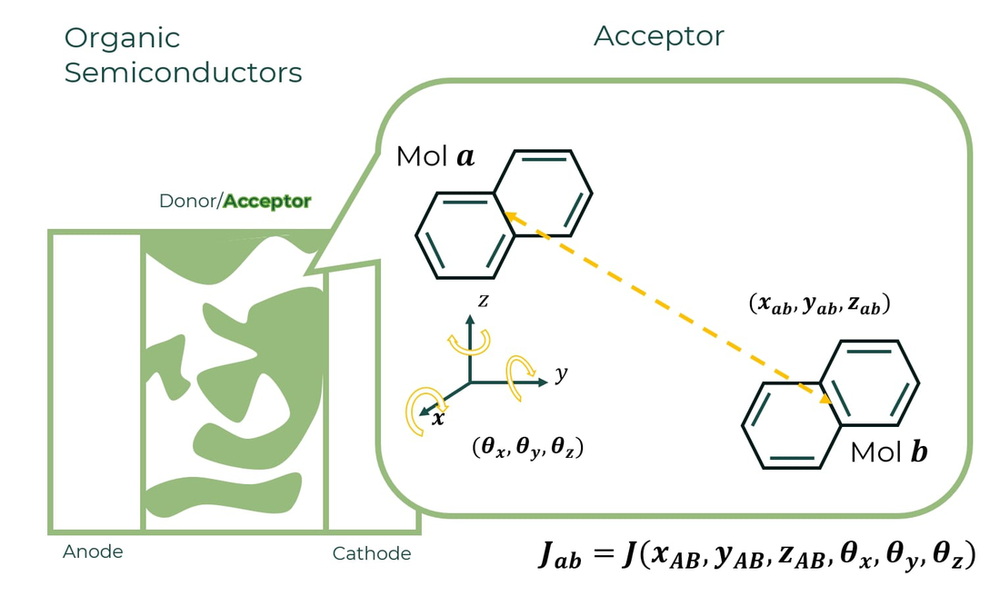
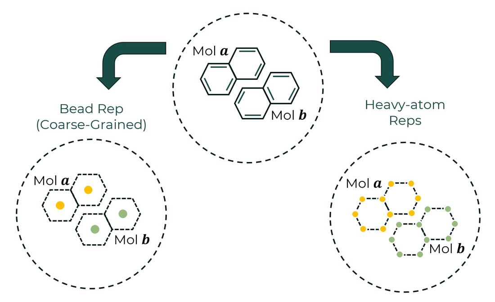
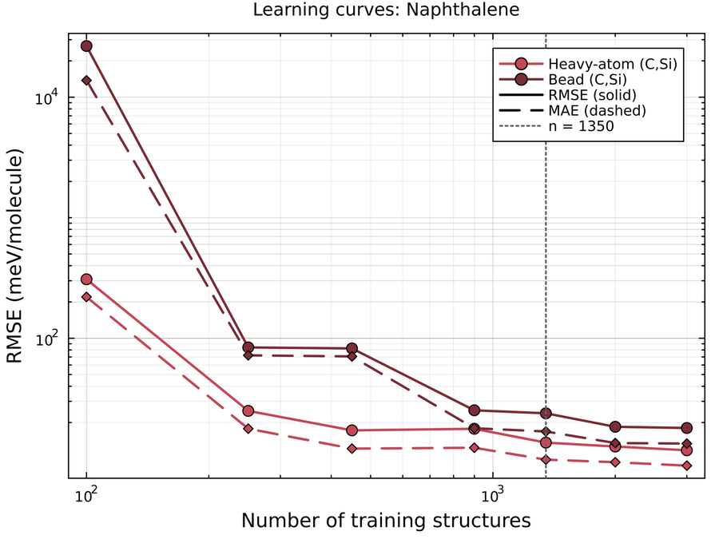
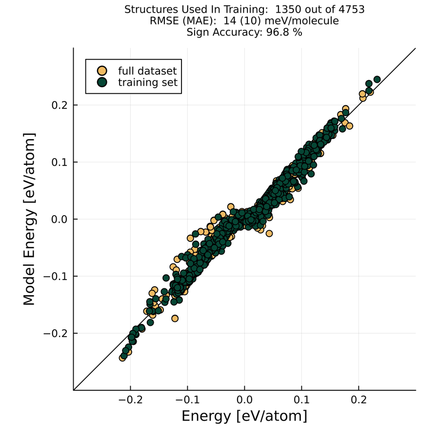

# ACE-TransferInts.jl

[](https://github.com/Frost-group/ACE-TransferInts.jl/actions/workflows/CI.yml?query=branch%3Amain)
[](https://arxiv.org/abs/2511.06551)
[](LICENSE)

**Machine-learning the electronic coupling between molecules from a few thousand examples.**
Charge moves through an organic semiconductor by hopping between neighbouring molecules. The hopping rate is set by
the *transfer integral* $J_{ab}$, which depends on all six degrees of freedom of the dimer's relative position and
orientation, and normally costs a quantum-chemistry calculation for every pair.
This package extends the **Atomic Cluster Expansion (ACE)** so it respects the symmetries of transfer integrals.
The result is a fast, data-efficient surrogate model for $J_{ab}$.

<p align="center">
  
</p>

## Highlights

From [*Machine learning intermolecular transfer integrals with compact atomic cluster representations*](https://arxiv.org/abs/2511.06551)
(K. Keeratikarn, C. Ortner, J. M. Frost):

- **Data-efficient.** For naphthalene, an MAE of **9.8 meV/molecule** from **1,350** training dimers. That is close to
  published neural networks (≈ 6.5 meV) trained on **120,000**. Kernel ridge regression reaches 2.0 meV, but needs
  15,000–40,000 samples.
- **Sign-aware.** The model predicts the *signed* transfer integral and gets the phase right for **96.8 %** of naphthalene dimers.
- **Physically built in.** ACE is invariant to rotation, translation and permutation, and $E_{\rm ref}=0$ forces
  $J \to 0$ for isolated molecules.
- **Compact representations.** A heavy-atom representation, and a coarse-grained *bead* model that is a candidate for
  larger chromophores.

<p align="center">
  
</p>
<p align="center"><sub>Two compact representations of a naphthalene dimer: coarse-grained beads (one per ring) and heavy atoms only.</sub></p>

## Results

<table>
  <tr>
    <td width="50%"></td>
    <td width="50%"></td>
  </tr>
  <tr>
    <td><sub>Naphthalene learning curves (RMSE solid, MAE dashed). The heavy-atom model is accurate from about 450 structures, while the bead model needs about 900.</sub></td>
    <td><sub>Predicted against reference transfer integrals for naphthalene, with the heavy-atom model trained on 1,350 of 4,753 dimers.</sub></td>
  </tr>
</table>

| Molecule | Representation | Dataset | Training set | RMSE | MAE |
|---|---|---|---|---|---|
| Ethylene | heavy atom (C) | 8,000 | 2,000 | 3.2 μeV/mol | 2.3 μeV/mol |
| Thiophene | heavy atom (C) | 8,000 | 2,000 | 3.10 μeV/mol | 2.03 μeV/mol |
| Thiophene | heavy atom (C + S) | 8,000 | 2,000 | 2.65 μeV/mol | 1.40 μeV/mol |
| Naphthalene | two-bead coarse-grained | 4,753 | 1,350 | 23.9 meV/mol | 16.9 meV/mol |
| Naphthalene | heavy atom (C) | 4,753 | 1,350 | 13.6 meV/mol | 9.8 meV/mol |

Adding a separate sulphur channel for thiophene cuts the RMSE by ≈ 15 % and the MAE by ≈ 40 %, at the cost of
15 → 20 min training time. Learning curves for ethylene and thiophene are in
[`docs/figures/learning_curves_ethylene_thiophene.png`](docs/figures/learning_curves_ethylene_thiophene.png).

## How it works

1. **Data.** Dimers are generated by rotating and translating a monomer through $(x, y, z, \theta_x, \theta_y, \theta_z)$.
   Signed transfer integrals come from [xtb-dipro](https://github.com/grimme-lab/xtb), modified to output the phase of $J$.
2. **Representation.** Hydrogens are dropped, leaving heavy atoms, or rings are collapsed to beads. Each molecule's sites are
   labelled as a separate pseudo-element, so ACE can tell the two molecules apart.
3. **Basis.** ACE basis with body order $N = 2$ and total degree $D_{\rm tot} = 10$. The cutoff $r_{\rm cut}$ (7.5, 9.0 and 13.6 Å) is
   chosen from the dimer radial distribution functions. The Agnesi transform uses high $p, q$ (19, 43–45), which concentrates the radial
   basis on the intermolecular range.
4. **Fit.** Bayesian linear regression with [ACEpotentials.jl](https://github.com/ACEsuit/ACEpotentials.jl). A BLR committee
   gives a per-configuration uncertainty $\sigma(\mathbf{x}) = \mathrm{std}_m\, J^{(m)}(\mathbf{x})$, which grows sharply outside the
   sampled range and so flags extrapolation.

## Quick start

ACEpotentials.jl lives in the ACEsuit registry, so add that first:

```julia
using Pkg
Pkg.Registry.add(RegistrySpec(url = "https://github.com/ACEsuit/ACEregistry"))
Pkg.add(url = "https://github.com/Frost-group/ACE-TransferInts.jl")
```

```julia
using ACETransferInts

params, J, logJ = read_J("out.dat")                 # dimer parameters and transfer integrals
construct_dimer("monomer.extxyz", "dimers.extxyz", params, π/3, J)

rmse(J_pred, J_ref), mae(J_pred, J_ref)
sign_accuracy(J_pred, J_ref)                        # fraction with the correct phase
n, rmse_v, mae_v, sign_acc = read_lc_csv("experiments/ethylene/results/LC_Ethylene_CSi_od2_td10_p19_q45_rcut75.csv")
```

The ACE fitting scripts for each molecule are in `experiments/`.

## Repository layout

| Path | Contents |
|---|---|
| `src/` | Library: dimer geometry (`dimer.jl`), metrics (`fitting.jl`), I/O (`io.jl`) |
| `test/` | Tests for rotations, metrics and learning-curve I/O |
| `experiments/naphthalene/` | Data generation and ACE fits for the heavy-atom and bead models |
| `experiments/{ethylene,thiophene}/results/` | Learning-curve data |
| `notebooks/` | Learning-curve analysis and the paper figures |
| `archive/Notebook_2024-2025/` | Chronological research notebooks, kept as the historical record, including the basis-stability sweeps in `2025_06/` |
| `docs/` | Documenter.jl site and README figures |

## Citation

```bibtex
@misc{keeratikarn2025transfer,
  title         = {Machine learning intermolecular transfer integrals with compact atomic cluster representations},
  author        = {Keeratikarn, Keerati and Ortner, Christoph and Frost, Jarvist Moore},
  year          = {2025},
  eprint        = {2511.06551},
  archivePrefix = {arXiv},
  primaryClass  = {cond-mat.dis-nn},
  url           = {https://arxiv.org/abs/2511.06551}
}
```

## Authors

Developed by **[Keerati Keeratikarn](https://github.com/PKKeerati)** (Imperial College London), with
[Christoph Ortner](https://github.com/cortner) (UBC) and [Jarvist Moore Frost](https://github.com/jarvist)
([Frost group](https://github.com/Frost-group)). MIT licence.
